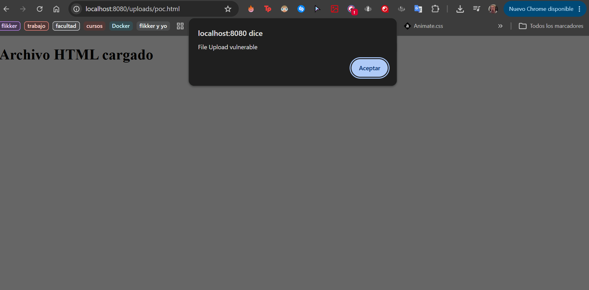
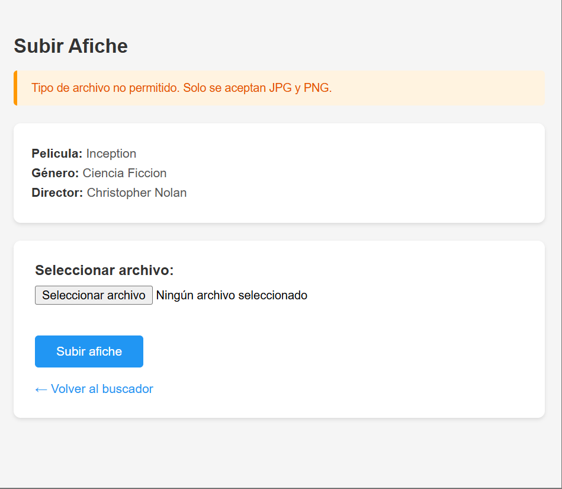
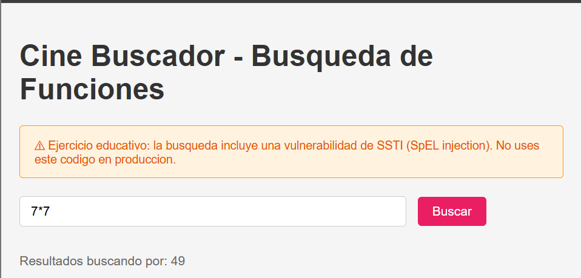
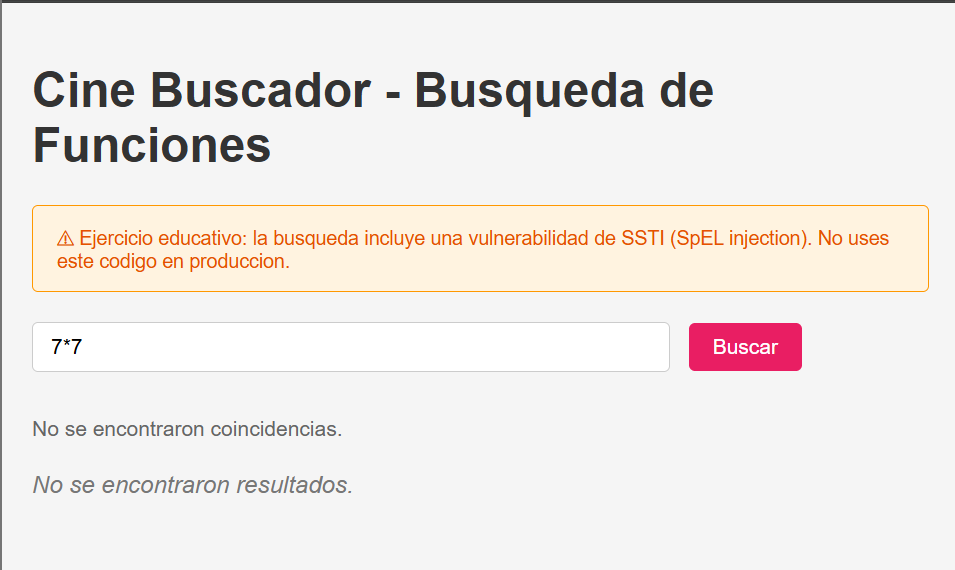
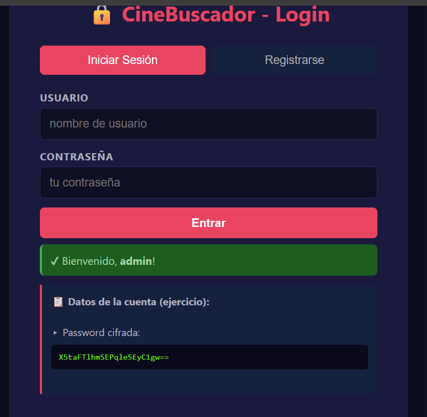
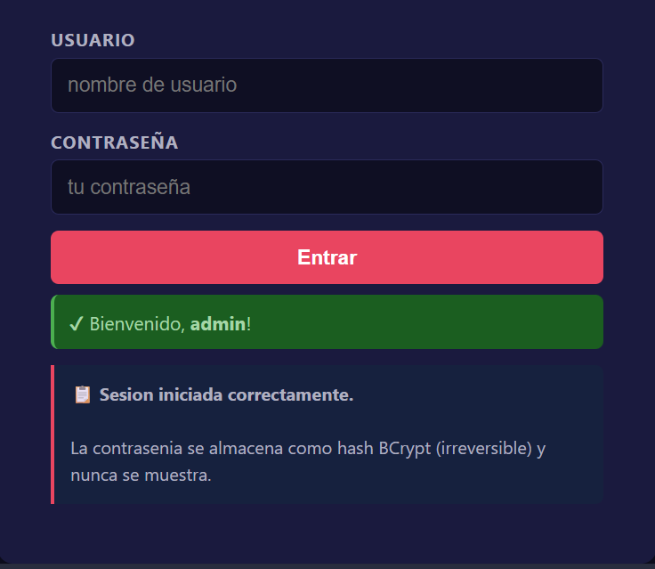

# Práctico 2 - Mitigación de vulnerabilidades CWE

**Estudiante:** Fabrizio Rodríguez  
**Rama:** `practico-2`

## Ejercicio 1 - SQL Injection

### Hallazgo

Se encontró una vulnerabilidad **SQL Injection (CWE-89)** en el buscador. El valor ingresado se concatenaba directamente en la consulta:

```python
WHERE peliculas.nombre LIKE '%{query}%'
```

### Prueba de concepto

Se ejecutó la aplicación y se ingresó:

```sql
' OR 1=1 --
```

La condición `1=1` siempre es verdadera y `--` comenta el resto de la consulta. Como resultado, la aplicación mostró las 21 funciones existentes.


### Mitigación

Se reemplazó la concatenación por una consulta parametrizada:

```python
WHERE peliculas.nombre LIKE ?
```

```python
db.execute(sql, (f"%{query}%",))
```

También se limitaron la columna y la dirección de ordenamiento a valores permitidos.

### Verificación

Se volvió a ingresar el mismo payload y la aplicación lo interpretó como texto normal, devolviendo 0 resultados. La búsqueda legítima `Dune` continuó funcionando.


---

## Ejercicio 2 - Cross-Site Scripting almacenado

### Hallazgo

Se encontró una vulnerabilidad de **XSS almacenado (CWE-79)** en la descripción de las películas.

La plantilla desactivaba el escape automático de Jinja mediante el filtro `safe`:

```jinja2
{{ pelicula['descripcion'] | safe }}
```

### Prueba de concepto

Se editó una película y se guardó como descripción:

```html

```

Al volver a abrir la edición, el navegador ejecutó el código y mostró una alerta. Esto demuestra que el contenido malicioso quedó almacenado en la base de datos.


### Mitigación

Se eliminó el filtro `safe`:

```jinja2
{{ pelicula['descripcion'] }}
```

De esta forma, Jinja escapa automáticamente el contenido ingresado y evita que sea interpretado como HTML ejecutable.

### Verificación

Se volvió a abrir la película que contenía el payload. El código se mostró como texto y la alerta dejó de ejecutarse.


---

## Ejercicio 3 - File Upload

### Hallazgo

Se encontró una vulnerabilidad de **subida de archivos sin restricciones (CWE-434: Unrestricted Upload of File with Dangerous Type)**, acompañada de **Path Traversal (CWE-22)** en el endpoint `POST /upload/{id}`.

El controlador guardaba el archivo usando directamente el nombre original enviado por el cliente, sin validar tipo, extensión, tamaño ni la ruta de destino:

```java
String filename = archivo.getOriginalFilename();
Path uploadPath = Paths.get(uploadDir);
Files.copy(archivo.getInputStream(), uploadPath.resolve(filename));
pelicula.setAfichePath(filename);
```

Esto permite: (1) subir cualquier tipo de archivo (por ejemplo HTML con JavaScript, que luego se sirve y ejecuta en el navegador), y (2) usar un nombre como `../../algo` para escribir fuera del directorio de subida.

### Prueba de concepto

1. Se abrió el formulario de subida de una película, por ejemplo `http://localhost:8080/upload/1`.
2. Se creó un archivo malicioso `poc.html` con el siguiente contenido:

   ```html
   <script>alert('File Upload - ' + document.domain)</script>
   ```

3. Se seleccionó ese archivo y se envió el formulario. El servidor lo aceptó y lo guardó con su nombre original.
4. Se accedió al archivo servido en `http://localhost:8080/uploads/poc.html`. El navegador interpretó el HTML y ejecutó el `alert`, confirmando que se puede subir y servir contenido activo arbitrario.



### Mitigación

Se reescribió el método `uploadFile` para aplicar defensa en profundidad ([PeliculaController.java](Ejercicio3/src/main/java/com/cinebuscador/controller/PeliculaController.java)):

- **Whitelist de extensiones** (`jpg`, `jpeg`, `png`) y de **tipos MIME** (`image/jpeg`, `image/png`).
- **Validación del contenido real** con `URLConnection.guessContentTypeFromStream` (magic bytes), para no confiar solo en la extensión declarada.
- **Nombre de archivo aleatorio** con `UUID`: nunca se usa el nombre enviado por el usuario.
- **Contención de ruta**: se normaliza el destino y se verifica con `startsWith` que no escape del directorio de subida (anti path traversal), también al servir el archivo en `serveFile`.
- **Límite de tamaño** (2 MB) en el código y en `application.properties`.

```java
if (!EXT_PERMITIDAS.contains(ext)) { /* rechazar */ }
String detectado = URLConnection.guessContentTypeFromStream(bis);
if (contentType == null || !MIME_PERMITIDOS.contains(contentType)
        || detectado == null || !MIME_PERMITIDOS.contains(detectado)) { /* rechazar */ }
String safeName = UUID.randomUUID() + "." + ext;
Path destino = uploadPath.resolve(safeName).normalize();
if (!destino.startsWith(uploadPath)) { /* rechazar */ }
```

### Verificación

Se repitió el PoC subiendo `poc.html`: la aplicación lo rechazó con el mensaje "Tipo de archivo no permitido". Una imagen `.png` legítima se subió correctamente y quedó almacenada con un nombre aleatorio (UUID), demostrando que solo se aceptan imágenes válidas.



---

## Ejercicio 4 - Server Side Template Injection

### Hallazgo

Se encontró una vulnerabilidad de **Server Side Template Injection / Code Injection (CWE-94)** por evaluación de expresiones SpEL. La entrada del buscador se pasaba directamente a un evaluador de expresiones **SpEL** con un `StandardEvaluationContext` que además exponía `System` y `Runtime`:

```java
StandardEvaluationContext standardContext = new StandardEvaluationContext();
standardContext.setVariable("system", System.class);
standardContext.setVariable("runtime", Runtime.class);
var expr = parser.parseExpression(expression); // expression = entrada del usuario
Object result = expr.getValue(standardContext);
```

Evaluar la entrada del usuario como expresión permite **ejecución remota de código (RCE)**.

### Prueba de concepto

1. Se ejecutó la aplicación (`http://localhost:8080`).
2. En el campo "Buscar función" se ingresó una expresión SpEL aritmética, cuyo resultado se muestra en pantalla como término de búsqueda:

   ```
   7*7
   ```

   La aplicación respondió "Resultados buscando por: **49**", lo que prueba que la entrada se **evaluó como código** en el servidor (no se buscó el texto `7*7`).

3. Para evidenciar el acceso a clases del sistema (vector de RCE), se ingresó una expresión que lee estado interno del servidor:

   ```
   T(java.lang.System).getProperty('user.dir')
   ```

   La aplicación mostró la ruta de trabajo del proceso Java. Con la misma técnica de referencias de tipo `T(...)` se puede alcanzar `java.lang.Runtime` y ejecutar comandos, confirmando la ejecución remota de código.



### Mitigación

Se **eliminó por completo la evaluación de expresiones** sobre la entrada del usuario. El buscador ahora usa el texto ingresado como término de búsqueda literal ([FuncionController.java](Ejercicio4/src/main/java/com/cinebuscador/controller/FuncionController.java)):

```java
String termino = buscar.trim();
List<Funcion> resultados = funcionRepo.findAll().stream()
    .filter(f -> f.getNombreFuncion() != null &&
                 f.getNombreFuncion().toLowerCase().contains(termino.toLowerCase()))
    .collect(Collectors.toList());
```

Además se **eliminó la clase `SpelEvaluator`** (que exponía `System` y `Runtime`), de forma que el motor de expresiones peligroso ya no existe en el código.

### Verificación

Se ingresó nuevamente `7*7` y `T(java.lang.System).getProperty('user.dir')`. La aplicación los tomó como texto literal (busca funciones cuyo nombre contenga esa cadena) y no evaluó nada: no aparece `49` ni la ruta del servidor, solo "No se encontraron coincidencias".



---

## Ejercicio 5 - Almacenamiento inseguro

### Hallazgo

Se encontró **almacenamiento inseguro de contraseñas (CWE-256 / CWE-257)** combinado con **clave criptográfica embebida en el código (CWE-321)** y **uso de un modo de cifrado inseguro, ECB (CWE-327)**.

Las contraseñas se guardaban cifradas de forma **reversible** con AES en modo ECB y una clave fija escrita en el código fuente, y el login **descifraba** la contraseña para compararla:

```java
private static final String SECRET_KEY = "MySup3rS3cr3tK3y!2024CineBuscadorAES";
private static final String CIPHER_ALGO = "AES/ECB/PKCS5Padding";
String decryptedPassword = EncryptionService.decrypt(user.getPassword());
if (password.equals(decryptedPassword)) { /* login */ }
```

Cualquiera con acceso al código obtiene la clave y puede descifrar todas las contraseñas. Además ECB es determinístico (misma contraseña → mismo ciphertext) y la clase exponía métodos para volcar la clave (`getStaticKey`, `getKeyHex`).

### Prueba de concepto

1. Se registró un usuario, por ejemplo `admin` / `Password123`.
2. Se observó en la base H2 (o en el mensaje de la propia app) el valor almacenado: un Base64 reversible del cifrado AES/ECB.
3. Usando la clave embebida en el código (`SECRET_KEY`) se descifró el valor con AES-256-ECB, recuperando la contraseña original en texto plano. Esto demuestra que el almacenamiento es reversible con información presente en el propio repositorio.



### Mitigación

Se reemplazó el cifrado reversible por **hashing con BCrypt**, que es unidireccional (no se puede "descifrar") e incorpora **salt aleatorio por usuario** ([AuthController.java](Ejercicio5/src/main/java/com/cinebuscador/controller/AuthController.java)):

```java
private final PasswordEncoder passwordEncoder = new BCryptPasswordEncoder();

// Registro: se guarda el hash, no la contrasenia
nuevoUsuario.setPassword(passwordEncoder.encode(password));

// Login: se compara contra el hash, sin descifrar
if (passwordEncoder.matches(password, user.getPassword())) { /* login */ }
```

- Se agregó la dependencia `spring-security-crypto` en el `pom.xml`.
- Se **eliminó la clase `EncryptionService`** (clave embebida, ECB y métodos que exponían la clave).
- Se dejó de mostrar la contraseña almacenada en la vista posterior al login.

### Verificación

Se registró un usuario nuevo y en la base quedó almacenado un hash BCrypt (formato `$2a$10$...`), distinto en cada registro aunque la contraseña sea la misma (por el salt), e imposible de revertir. El login sigue funcionando con la contraseña correcta y falla con una incorrecta.


