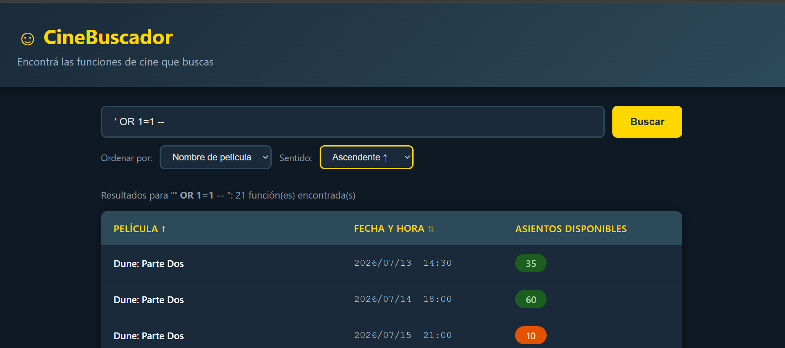
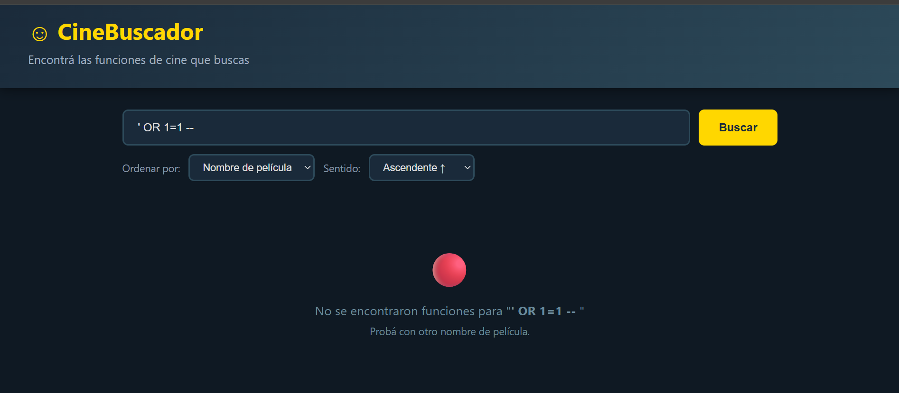
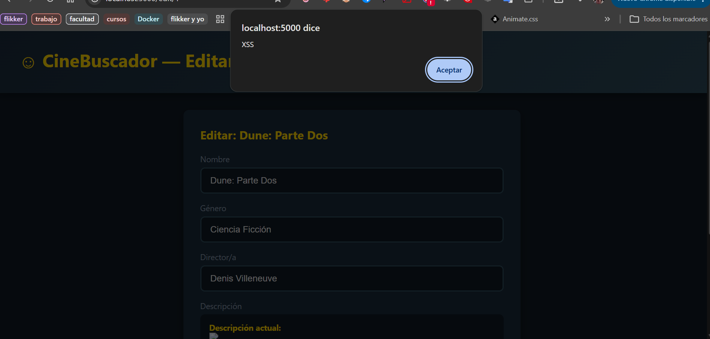
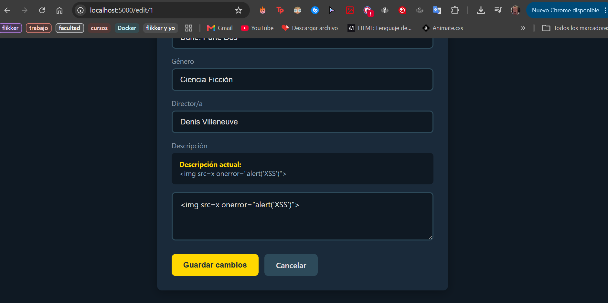

# Práctico 2 - Mitigación de vulnerabilidades CWE

**Estudiante:** Fabrizio Rodríguez  
**Rama:** `practico-2`

## Ejercicio 1 - SQL Injection

### Hallazgo

Se encontró una vulnerabilidad **SQL Injection (CWE-89)** en el buscador. El valor ingresado se concatenaba directamente en la consulta:

```python
WHERE peliculas.nombre LIKE '%{query}%'
```

### Prueba de concepto

Se ejecutó la aplicación y se ingresó:

```sql
' OR 1=1 --
```

La condición `1=1` siempre es verdadera y `--` comenta el resto de la consulta. Como resultado, la aplicación mostró las 21 funciones existentes.



### Mitigación

Se reemplazó la concatenación por una consulta parametrizada:

```python
WHERE peliculas.nombre LIKE ?
```

```python
db.execute(sql, (f"%{query}%",))
```

También se limitaron la columna y la dirección de ordenamiento a valores permitidos.

### Verificación

Se volvió a ingresar el mismo payload y la aplicación lo interpretó como texto normal, devolviendo 0 resultados. La búsqueda legítima `Dune` continuó funcionando.



---

## Ejercicio 2 - Cross-Site Scripting almacenado

### Hallazgo

Se encontró una vulnerabilidad de **XSS almacenado (CWE-79)** en la descripción de las películas.

La plantilla desactivaba el escape automático de Jinja mediante el filtro `safe`:

```jinja2
{{ pelicula['descripcion'] | safe }}
```

### Prueba de concepto

Se editó una película y se guardó como descripción:

```html

```

Al volver a abrir la edición, el navegador ejecutó el código y mostró una alerta. Esto demuestra que el contenido malicioso quedó almacenado en la base de datos.



### Mitigación

Se eliminó el filtro `safe`:

```jinja2
{{ pelicula['descripcion'] }}
```

De esta forma, Jinja escapa automáticamente el contenido ingresado y evita que sea interpretado como HTML ejecutable.

### Verificación

Se volvió a abrir la película que contenía el payload. El código se mostró como texto y la alerta dejó de ejecutarse.


